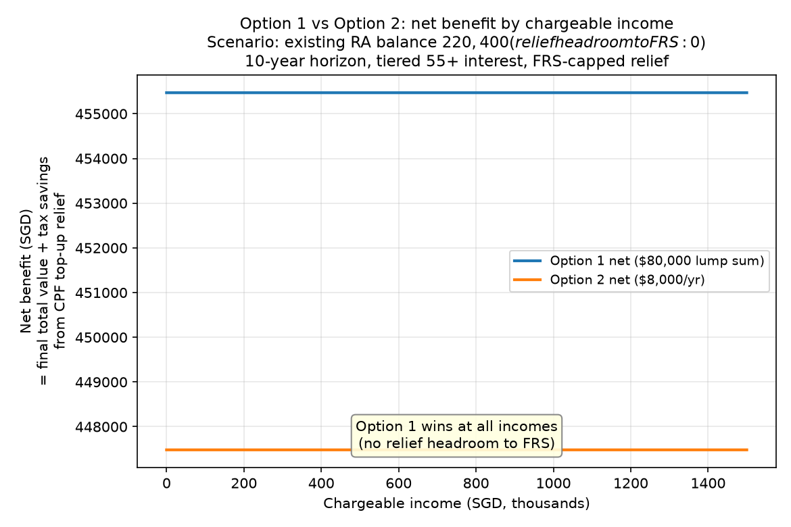
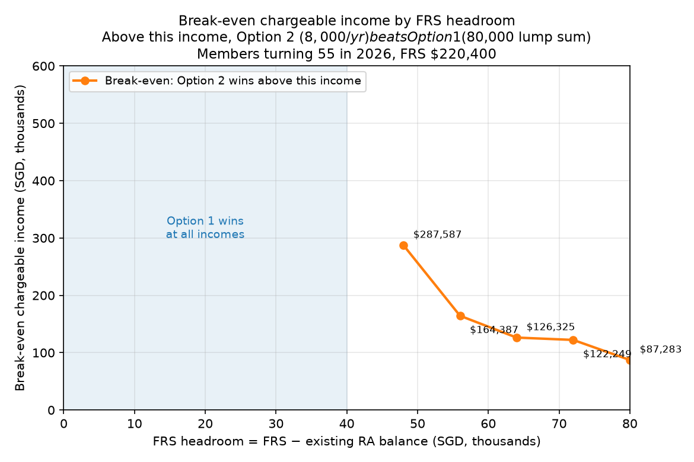

# CPF RA Top-Up Analysis

Comparing two strategies to deploy $80,000 into a CPF Retirement Account (RA) at age 55 over a 10-year horizon, under the current IRAS/CPF rules:

1. **FRS-capped tax relief** — CPF Cash Top-up Relief (max $8,000/YA) is only granted for the portion of a top-up that fills the RA up to the Full Retirement Sum (FRS). Top-ups above FRS (up to ERS) earn interest but no relief.
2. **Tiered 55+ interest** — RA interest is 6% on the first $30,000, 5% on the next $30,000, 4% on the rest of the combined SA/RA balance (4% base + 2%/1% additional interest). If your existing RA balance already exceeds $60,000 (true for any standard 55+ member; minimum BRS is $110,200), all top-up dollars earn a flat 4%.

## Options Compared

| | Option 1: Lump Sum | Option 2: Annual Top-ups |
|---|---|---|
| **Deposit** | $80,000 at Year 1 start | $8,000/year for 10 years |
| **CPF RA interest** | Tiered 55+ rates on total balance | Tiered 55+ rates on total balance |
| **Outside interest** | — | 2.5% p.a. on unused funds |
| **Tax relief** | $8,000 in Year 1 only, **if below FRS** | $8,000/year while below FRS |

## Key Results (default scenario: existing RA at FRS, $220,400)

Top-up dollars earn a flat 4% in both options, and **no tax relief attaches to either option** (RA already at FRS).

| | Option 1 | Option 2 |
|---|---|---|
| Top-up value at Year 10 | **$118,419.54** | $99,890.81 + $10,539.03 outside |
| **Total value** | **$118,419.54** | **$110,429.84** |

**Option 1 (lump sum) wins at every income level, by $7,989.70.** The balance gap is income-independent; only the tax side varies with the member's position relative to FRS (Figure 1 shows this scenario's net-benefit curves).



## Decision Rule: Two Dimensions

The winner depends on two things: the existing RA balance relative to FRS, and the marginal tax bracket (Figure 2 maps this rule):

| Headroom to FRS (G = FRS − RA) | RA Balance (2026 FRS $220,400) | Result |
|---|---|---|
| $0 – $40,000 | $180,400 – $220,400 | **Option 1 wins at all incomes** |
| $48,000 | $172,400 | Option 2 wins only above ~$287,587 |
| $56,000 | $164,400 | Option 2 wins only above ~$164,387 |
| $64,000 | $156,400 | Option 2 wins only above ~$126,325 |
| $72,000 | $148,400 | Option 2 wins only above ~$122,249 |
| $80,000+ | ≤ $140,400 | Option 2 wins above ~$87,283 |

Members with RA below ~$60,000 also get the preferential 6%/5% tiers on the top-up itself, which widens Option 1's balance gap (e.g. with a $40,000 existing balance the gap grows to ~$8,700 and the crossover moves to ~$87,750).



## Usage

```bash
# default scenario (RA at FRS 2026)
python3 cpf_ra_comparison.py

# your own RA balance
python3 cpf_ra_comparison.py --ra-balance 140400

# regenerate the chart
python3 make_crossover.py --ra-balance 140400   # needs matplotlib
```

Other flags: `--frs`, `--ers`, `--lump`, `--annual`, `--years`, `--start-age`, `--outside-rate`, `--out-dir`.

## Assumptions

- FRS $220,400 / ERS $440,800 (members turning 55 in 2026)
- CPF Cash Top-up Relief: $8,000/YA cap for self top-up; **cannot be carried forward**; FRS-capped
- Outside interest rate (Option 2 unused funds): 2.5% p.a. (assumption, not a guarantee — the CPF 4% base is a floor)
- Chargeable income constant across all 10 years
- No discounting (nominal comparison)
- Singapore progressive tax brackets (YA 2024 onwards)
- $80,000 total personal tax-relief cap ignored; MRSS grant interaction noted in the report

## Files

- [`cpf_ra_comparison.py`](cpf_ra_comparison.py) — analysis script (stdlib only, self-verifying)
- [`make_crossover.py`](make_crossover.py) — chart generator (matplotlib)
- [`cpf_ra_comparison_report.md`](cpf_ra_comparison_report.md) — full report with tables
- [`net_benefit.png`](net_benefit.png) — Figure 1: net benefit by chargeable income for the chosen scenario
- [`crossover_by_headroom.png`](crossover_by_headroom.png) — Figure 2: break-even chargeable income by FRS headroom
- [`research_findings.md`](research_findings.md) — IRAS/CPF source research

## Sources

- [IRAS Individual Income Tax Rates](https://www.iras.gov.sg/taxes/individual-income-tax/basics-of-individual-income-tax/tax-residency-and-tax-rates/individual-income-tax-rates)
- [IRAS CPF Cash Top-up Relief (incl. FRS limit on relief)](https://www.iras.gov.sg/taxes/individual-income-tax/basics-of-individual-income-tax/tax-reliefs-rebates-and-deductions/tax-reliefs/central-provident-fund-(cpf)-cash-top-up-relief)
- [CPF Board RA top-ups (ERS cap, additional interest)](https://www.cpf.gov.sg/member/growing-your-savings/saving-more-with-cpf/top-up-to-enjoy-higher-retirement-payouts)
